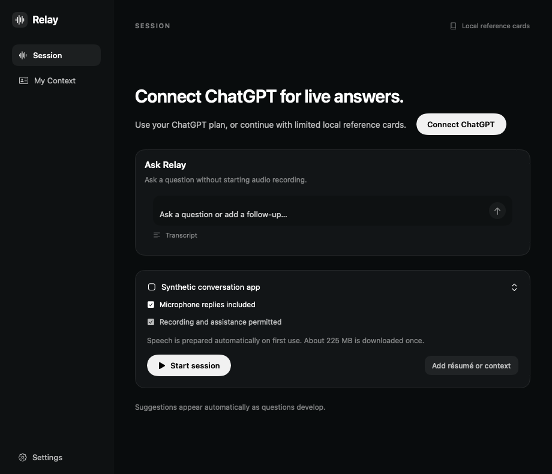
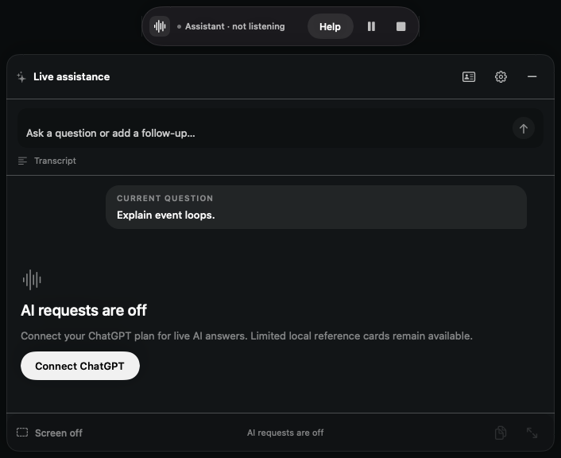

# First-launch account presentation evidence

These are synthetic offscreen renders of the actual SwiftUI views, created by `RelayRenderFixtureTests` on 2026-10-24. They are not screenshots of a running product window. The source controls, question and composer state are fictional/inert. Rendering starts no browser, account, Keychain, capture, model or network work. Existing Relay controls and SF Symbols are used; no competitor source or assets are copied.

Home retains its existing 920×790 geometry with the typed composer and keeps the local reference/audio paths visible. The recovery view is 706×576. Both routes select the existing AI settings page; only its explicit Continue with ChatGPT action starts login.

| File | Bytes | SHA-256 |
|---|---:|---|
| `first-launch-account.png` | 86393 | `2145641bbe6ddbcacab6cd05e2b1d98394af87df6343fe0d50cfd7d53c0d0eb8` |
| `ai-off-recovery.png` | 54257 | `1aef4bf738d6ed2536886d806bc365e86b26f7b46eacd98b6bd4a161afe7bb26` |
