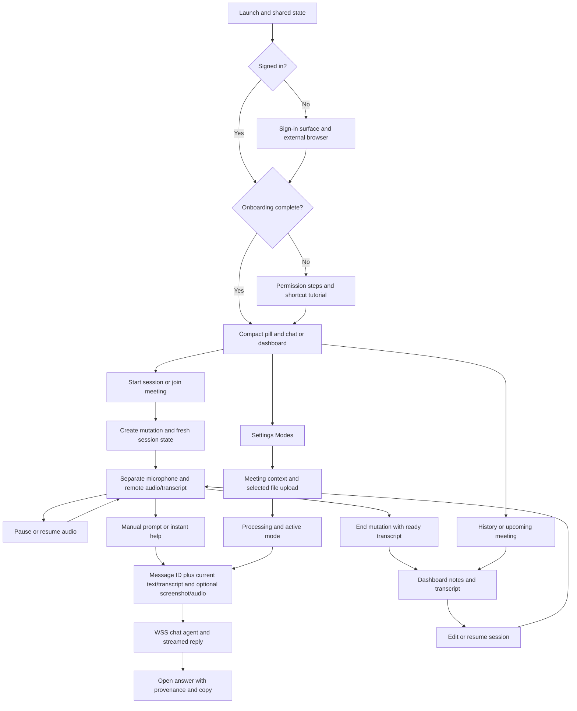

# Cluely product and UI deep dive

Research date: 2026-10-23. Owner: visual/research lane. Research only; no Relay runtime source changes.

The shipped 2.1.24 application is a compact control pill plus a 690px-wide, top-input chat/dashboard panel. Settings is a 920x670 window with a centered horizontal tab strip. The current renderer is a different generation from the Sep-Dec 2025 support screenshots: its About page announces a complete 2.0 rewrite dated April 3, 2026. The most useful Relay work is faithful surface hierarchy, a short session flow, a first-class background/preparation surface, clear context provenance, and usable transcript/history states. Copying the old guide's action row or inventing a generic bottom-composer assistant layout would miss the measured source.

Companions: [measured renderer specification](CLUELY_UI_MEASUREMENTS.md) and [source-coordinate ledger](CLUELY_SOURCE_COORDINATES.json). Raw extracted source/graphs/assets stay local.

## Evidence and limits

| Layer | Exact identity | What it establishes |
|---|---|---|
| Installed app | Cluely (New), bundle `com.cluely.app.april22`, version/build 2.1.24, bundle minimum macOS 12.0 | Frozen local target, not latest release on the website |
| ASAR |28,442,561 bytes; SHA256 `5ed201e85fc9de452b338887bffadca2a5dd1eef1f12fd101db81be02b0b28a0` | Exact input bytes |
| REA CLI | `rea-agents@6.7.0`, MIT; npm SHA1 `11f23ba377303a5c28b3162180cf2bf3f3643708` | Actual static analysis tool invoked locally |
| REA skill | Version 45; repo pin `f470350528ffdfd3f1ec800ffafbf24ae5c7b593`; skill blob `16e7c03fba39789989f4cb1089534bb10767f76b` | Current authoritative methodology read; local earlier skill pin `8d8d85ba22463b80715a1af1fdb51acc9b5d760b` was also retained |
| Parser/runtime | Babel parser 8.0.4 MIT; Node 24.22.1 darwin-arm64, Node MIT plus bundled notices | Execution-free independent syntax/JSX inventory |
| Official sources | Cluely landing, support articles and enterprise docs fetched during this investigation | Published product claims, some explicitly dated2025; not proof of installed2.1.24 behavior |

The Mac remained locked. No Cluely UI runtime was observed, no lock was bypassed, and no application bootstrap, renderer, native addon, account, credential, capture, permission, inference or private endpoint was exercised. No proprietary code, prompts, font files, icon paths, screenshots or other assets were copied into Relay. Public REA tooling was reused as a tool; Cluely is a functional/style reference only. No additional install was needed after inspecting the existing pinned tool and licenses.

Primary methodology: [REA repository](https://github.com/morluto/rea/tree/f470350528ffdfd3f1ec800ffafbf24ae5c7b593), [JavaScript application workflow](https://github.com/morluto/rea/blob/f470350528ffdfd3f1ec800ffafbf24ae5c7b593/docs/javascript-application-workflows.md), [exact skill](https://github.com/morluto/rea/blob/f470350528ffdfd3f1ec800ffafbf24ae5c7b593/.agents/skills/reverse-engineer-anything/SKILL.md).

## Coverage accounting

The earlier analysis selected seven JavaScript modules. This pass selected 39 exact paths: 37 JavaScript modules plus manifest/HTML, including control, routes, onboarding, permissions, create/end session, settings, mode tutorial, notification, and chat variants. REA read 2,603,757 text bytes, visited 612,597 AST nodes, had 0 parse failures, and produced 9,617 application nodes/12,181 edges. It retained 108,853 semantic nodes/94,170 relations/87,855 unknowns. The graph is PARTIAL and semantic coverage is TRUNCATED. Of 3,149 REA-relevant inventoried files, 3,110 remain outside selected source analysis. The ASAR inventory's3,266 total entries uses a different denominator.

Expanded Evidence: `ev_7b156c9d46420c594aa8519fef1fba7e18261a936dcb93719a6b8987ba867ca5`. The subscription-plan-selection module exceeded the remaining parent semantic-result budget; static/module facts were retained. The two protocol-client native addons already had declared integrity hashes inconsistent with observed bytes; they remain untrusted and were not executed/analyzed. Dynamic IPC expressions, imported aliases and unselected module relationships remain unresolved where REA could not prove them. The summary's low literal-IPC count does not establish that IPC is absent.

Three authenticated bounded outgoing feature traces were run against the complete Evidence envelope, not fabricated partial graph objects:

| Seed | Evidence | Result |
|---|---|---|
| create-session module | `ev_4980dcb56bfe5719358f335d42dd1b9de13fefc126feb3c40f28f654c8325d62` |60nodes/75edges;13terminal paths; partial |
| end-session module | `ev_27d6b5c7f14bcfea18f29e21ae797e47bc37ee2ab019745bcf110b1cad529f6f` |62nodes/75edges;14terminal paths; partial |
| control module | `ev_f1b282ce6a6281870429a956825ffb87184218d17c4e0df02e6ee3213f30769f` |81nodes/129edges;21terminal paths; partial |

Each module seed matched two graph identities. These traces recover imported/static relationships and explicit unavailable frontiers; they do not prove live callback execution. Independent inert Babel inspection covered 41 JavaScript files and 1,790 compiled JSX calls with 0 parse failures, following actual hook exports, destructured callback bindings, object fields, event channels and effects. Four CSS files were recovered directly from the pinned ASAR and hashed. This is a feature checklist plus entry/state/effect tracing, not a claim to have reconstructed the entire app.

Local evidence remains under `work/rea-research/deep-dive`: `rea-expanded-analysis.json`, `rea-command.json`, `rea-expanded-metadata.json`, `feature-trace-summary.json`, three trace files, `ui-ast-inventory.json`, `inventory.json`, `source-coordinate-ledger.json`, `developer-menu-guards.json`, and `renderer-spec.md`. Only the sanitized report/spec/coordinate ledger should be published. Raw graph/source/CSS stays local.

## Measured visual specification

The complete measured packet is [renderer-spec.md](CLUELY_UI_MEASUREMENTS.md). Its source ledger has24 evidence coordinates and exact member hashes. Ranges are UTF-8 bytes with exclusive end; Babel line columns are UTF-16 columns.

| Surface | Shipped source measurements | Evidence |
|---|---|---|
| Pill |163x50; outerpadding2; fullround dark translucent backdrop;26px logo12fromleft;66x32 Ask/Hide; two32px session buttons;6px control gaps |S01/S02 |
| Chat |690fixedwidth;104collapsed,120in invisible state;500expanded;760dashboard; separate from pill |S01 |
| Input |Top56px row;15px/20line;18verticalpadding; roundedtop16; placeholderwhite50% |S04 |
| Answer |Open rich text, no surrounding assistant bubble;14px/24 from prose-sm;12horizontal/14bottompadding |S03/S05/S24 |
| User message |Right bubble,max78%width;17radius exceptbottomright6;14x10padding;13pxmedium/20line;white92% |S05 |
| Footer |48height;1fr/auto/1fr grid;12sidepadding;40px nav actions,radius12,12pxsemibold |S04 |
| Transcript |16padding;52px timestampcolumn+12gap;11px timestamp/speaker;13px/20liveplaceholder |S06 |
| History |Min56rows;40pxicons;12radius;12horizontal/8verticalpadding;14px title,12pxdetail |S07 |
| Settings |920x670,minwidth760;top horizontal icon+label tabs;28px title row;max860nav;max760content,padding32x28 |S01/S13/S14 |
| Onboarding |1100x720,fixed; dark split surface with staged learning/permission flow |S01/S10/S11 |
| Meeting alert |360x300;15from primary workarea top/right |S01 |

Body font is Geist Variable, not Inter. The Relay adaptation can use SF with the measured sizes and weights. Spacing unit is4px at the default root, weight400/500/600, base radius10. General dark background is `oklch(14.1% .005 285.823)`, foreground98.5%white; card/popover `oklch(21% .006 285.885)`. Live surfaces have explicit white-opacity layers. Settings uses RGB9/12/13 outer and12/15/16 content. No asset or source transplant is needed for these functional proportions.

The pill background is draggable independently of its actions. Ask/Hide toggles the chat surface. The left session action really invokes endSession; the right really invokes createSession, confirmed through imported hook binding, not guessed from icon shape. Chat follows the control window and has fixed width. The source's always-on-top, frameless and skip-taskbar configuration is a measured window behavior, not a recommendation to adopt concealment.

## Entry/state/effect flow map

Edges describe client source relationships and state intent. Cloud agent processing, generated summaries, retrieval, identity services and speaker reasoning are outside the observed implementation boundary.

## Feature traces and product coverage

| Area | Direct shipped-source findings | Official claims/version conflict | Coverage and Relay implication |
|---|---|---|---|
| Setup/account | Signed-out route goes to sign-in; external browser action; permissions and mode tutorial branches. Sign-in state is loading/signed-in/signed-out. Profile/Security use a distinct embedded surface. S10/S11/S22. | March2026 support describes browser login/deep-link return, but no account flow was performed. | Static client partial. Relay needs an understandable setup/readiness surface; do not replace its official subscription OAuth with competitor auth. |
| Permissions | Separate accessibility, microphone and screen statuses; denied state opens specific system settings; screen grant can require relaunch; Continue moves to mode tutorial. S11. | Quickstart's macOS10.15 claim conflicts with installed bundle's minimum12.0. | Source answered; runtime denied/relaunch unknown. Relay should explain each selected source and permission, not demand every capability just to reach Home. |
| Idle/home | Pill and chat/dashboard modes are distinct; chat can be collapsed. Main Home has upcoming meetings, history and detail panes. S01/S02/S07. | Older docs say Activity is default dashboard. | Static answered. Preserve690width/hierarchy and a simple useful Home; do not expose implementation controls as the primary product. |
| Start | createSession invokes sessions.create with plan/meeting context; only success resets chat and initializes a fresh unpaused session/transcript. Quota failure routes to billing. S08. | Guides advertise Start/Join from dashboard or meeting alert. | Client answered; server quota unknown. Relay Start must retain actual readiness/authority checks and visible failure. |
| Pause/resume | Main chat has Pause/Resume Audio Session, with explicit pausedAt/pausedDuration state for timer accounting. S04/S19. | Older guides often say audio toggle, which is less precise. | State/UI answered; all underlying audio/service races not proven. Relay's existing cancellation/source fences must survive visual redesign. |
| End | sessions.end sends ready transcript entries; state clears session/pause and opens expanded dashboard. S09. | Post-call docs promise generated notes after meaningful captured audio. | Client answered; cloud summary success unknown. End differs from Hide and from New Chat. |
| Transcription | Separate me/them activity and transcript entries; real Transcript pane and copy; empty/currently-talking states. S06/S19. | Individual support for1.89 says widget transcript removed; installed2.1.24 source has it. | Source wins current spec. Relay should expose actual transcript/source status, not a decorative empty tab. No accuracy/latency claims measured. |
| Automatic/manual suggestions | Source proves manual form, global chat-submit, context construction, streamed agent state and pending replacement while busy. Blank instant-help has a display label; no static old five-button action row was established. S18. | Sep 2025 guide describes dynamic transcript suggestions and quick actions; Dec2025 support describes Assist versus Say Next. Neither proves automatic answer publication in2.1.24. | Manual answered; automatic/server generation partial/unknown. Relay's accepted automatic routing is its own behavior, not reverse-engineered proof from Cluely. |
| Typed questions | Top prompt supports typed submit, stop while streaming, search/home navigation and keyboard focus. Blank action uses current context rather than requiring typed text. S04/S18. | Dashboard support describes two CmdEnter presses and typedEnter. | Client answered. This is a meaningful Relay functional gap, requiring actual host wiring, not an inert TextField. |
| Screen context | Main screenshot handler chooses the display containing the app panel, fallback primary; one screenshot result. Upload uses original messageId and Base64/contentType; preview has Viewed screen/loading/failure. S05/S16/S18. | Website claims screen understanding; older guide says one fresh screenshot per query. | Client paths answered; runtime bytes/selection unknown. Relay should preserve selected-window, request-bound permissions and explicit visual capability verification; do not copy screen-wide authority. |
| Screen setting | Persistent schema has screenUse required default; query metadata distinguishes Uses Screen/Does not use screen. S18/main schema. |1.89 guide says always-used screen; installed schema permits a different state. | Static partial. A source label must reflect actual sent context. |
| Keyboard/focus | Global dispatch toggles focus/blur and chat-submit; editable shortcut schema; drag/reset control; Backspace/Escape/Tab navigation and response scroll affordance. S02/S17/S18. | Docs conflict between CmdEnter Ask versus Assist, and different screenshot chords. | Source answered for schema/handlers; OS registration/focus not observed. Use Relay's normal visible windows and tested shortcuts; no need to clone stealth. |
| Settings | Nine top tabs: General, Calendar, Notifications, Modes, Keybinds, Profile, Security, Billing, About. General includes updates, launch at login, usage, languages, microphone test. S13-S15. |2025 guide had fewer/different groupings and Ambient Chat under Advanced. | Actual2.1.24 hierarchy answered. Ambient/Advanced is a dated official claim, not confirmed present in this UI. |
| Developer controls | Main menu has five DevTools targets: Auth, Onboarding, Control, Chat, Notification. It is in the alternate branch of `VITE_IS_PROD === 'true'`. S21. Persistent noFocusWhenInvisible/smartMode fields exist. | No official guarantee these are available in release UI. | Static guard answered; effective build flag/runtime availability unknown. Keep Relay developer diagnostics outside ordinary user surfaces. |
| Modes/instructions | List/create/edit/delete/setActive/setAllInactive APIs; General has no custom prompt/template/files. Context textarea, name edit, active indicator; interview/case/coding/system-design/recruiter templates exist. S12. | Customization docs describe scenario-specific system instructions and file attachments. | Client answered; prompt/RAG behavior unknown. Build Relay background and answer preferences with actual provenance, not arbitrary files treated as verified biography. |
| File ingestion | Client displays20MB limit; signed upload creation then PUT then file record; polling sync status; Processing tooltip says usable after processing; file View/Delete and upload error/quota states. S12. | Individual support lists PDF/DOCX/TXT and resume/project examples, plus plan limits. | Client answered; document parsing/security/retrieval unknown. Relay already has selected TXT/PDF/DOCX preparation and explicit review; improve discoverability and progress/status before adding duplicate ingestion. |
| History/notes | Sessions list/detail, title and markdown summary editing, transcript, resume, row actions including trash, share-text copy; linked upcoming meeting overview. S07. | Older docs promise notes, next steps, public-link sharing, deleted-session controls. | Client partial; public-link access control and final summaries untested. Relay history needs explicit local retention choices; do not silently persist raw audio/transcript. |
| Calendar/pre-call | Connect/disconnect Google Calendar, refresh, meeting alert, brief loading/insufficient-context states and Join Now. S07/S15. | Docs say participant research/briefs and Google-only as ofAug 2025. | Client partial; live sync/brief generation unknown. Useful later individual workflow, not prerequisite for interview copilot usability. |
| Failure/reconnect | Agent exposes reconnect and persistent-disconnect state;10s UI delay; rejects pending RPC when connection closes; prompt stop/error states. Audio test has connecting/permission failure. Updater events available/downloaded/error plus Check/Download/Restart. S15/S18/S20. | Audio and calendar troubleshooting docs describe permissions/devices/account reconnection. | Client answered; network recovery effectiveness untested. Relay needs concise recoverable error states without fake online/verified badges. |
| Enterprise | No enterprise account or private endpoint inspected. | Official docs describe files/live links, CRM/ATS via Merge.dev, organization roles, coaching and managed source setup. | Official-only. Research coverage does not authorize a CRM, team-admin or billing build. Individual desktop scope ranks higher. |

## Relay baseline and sequencing

Parity was checked against exact Relay commit `1f8e7fbc7e4c7a2f925e1380ddec67f46c5fc3a7`, including current native app/settings/profile views, BUILD_CONTRACT and the personal lane source/docs. Earlier PERSONAL_BRAIN_STORAGE is historical and explicitly describes a smaller prototype; it must not be used alone to claim current ingestion is absent. The baseline already includes selected TXT/PDF/DOCX preparation, entered notes/job excerpts, actor/source review, approved-fact retrieval, source revocation, encrypted native profile persistence and actual shared-helper composition. Real private-file/Keychain/account/hardware acceptance remains separate.

| Priority | Work | Concrete reason and boundary |
|---|---|---|
| P0 | Rebuild presentation around pill,690chat/top prompt/open answer and920x670top-tab Settings | Direct current source measurements; original Relay branding/SF, existing source/answer authority unchanged. UI lane now has the exact packet. |
| P0 | Bring existing protected background prep into primary navigation | User asked for resume/personal memory. Reuse working importer/review/storage; show Selected, Reviewing, Approved, Revoked/Locked states and actor/source locator. No automatic biographical promotion. |
| P0 | Friendly readiness and source selection | Surface app/audio/screen and optional visual verification in ordinary language. Keep detector/model-path diagnostics in setup/details, not permanent live chrome. |
| P1 | Real typed question and compact context-aware Help | Top prompt is core observed behavior. Add actual host/request handling and meaningful busy/cancel/error states before displaying input controls. |
| P1 | Actual transcript and small local session activity/history | Useful during and after mock/interview sessions. Decide retention and delete/export UX before writing new private data. Reuse current transcript state; do not fabricate a completed notes product. |
| P1 | Functional modes/preferences | Role/context selection and answer presentation preferences with visible active scope. Existing Personal Brain authority and job-context distinction remain intact. |
| P2 | Session notes, search and resume | Clear product gap after core session UI. Treat generated notes as derived content, not verified personal facts. |
| P2 | Calendar/pre-call preparation | Valuable but separate authorization/integration. Individual supported workflow first. |
| Outside present desktop priority | Enterprise CRM/ATS, team RBAC, coaching ROI, billing clone, concealment/anti-detection | Not implied by user request for Cluely-like interview UX and personal memory. |

Important preserved difference: Cluely's attached mode documents provide context. Relay's confirmed personal facts require explicit source/actor review. A resume upload should finish in reviewable candidates; it must not silently become proof that the user personally implemented every team project. Meeting history, selected screen text, generated answers and custom instructions are separate from approved biography.

## Official source register

Each item was actually fetched during this investigation. Dates and claims belong to the page, not to installed2.1.24 verification. Some support URLs became inaccessible on a later refetch; their earlier fetched content informed only the dated-claim column above. The source-backed renderer specification is independent of those pages.

- [Cluely landing](https://cluely.com/): current marketing of live transcription, screen context and assistance; no runtime accuracy/latency benchmark performed.
- [Guide index](https://docs.cluely.com/llms.txt), [Quickstart](https://docs.cluely.com/quickstart): desktop/download/calendar entry points; platform requirements differ from installed bundle.
- [Live Insights](https://docs.cluely.com/feature/liveinsights): explicitlySep 2025 widget, drag/audio/end/hide, actions, modes and transcript candidates. This older guide is not the2.1.24 renderer spec.
- [Settings](https://docs.cluely.com/feature/settings): languages, display/login/update and editable shortcuts; [Meeting Notes](https://docs.cluely.com/feature/postcall): post-call activity, notes, transcript and session actions.
- [Pre-call Briefs](https://docs.cluely.com/feature/precall): calendar-linked participant/context preparation, Google-only datedAug 2025 and network-dependent research.
- [Knowledge Base](https://docs.cluely.com/enterprise/knowledgebase): enterprise files/live links/data sources and managed setup. Its retrieval/context-size/memory claims are unverified marketing/architecture descriptions.
- [How to use Cluely](https://support.cluely.com/en/articles/12294306-how-to-use-cluely), Dec 12, 2025: pill/Ask, action semantics and1.89 transcript change. The later installed2.1.24 contradicts the old widget-transcript description.
- [Dashboard](https://support.cluely.com/en/articles/12101340-how-to-use-cluely-s-dashboard-app), Oct 25, 2025: activity, notes, calendar, manual query and session lifecycle.
- [Customization](https://support.cluely.com/en/articles/12006358-how-to-customize-cluely), Dec 4, 2025: modes, scenario prompts, resume/project files. File limits/encryption claims were not independently verified.
- [Assist versus Say Next](https://support.cluely.com/en/articles/12665135-assist-vs-what-should-i-say-next), Oct 25, 2025; [Smart Mode](https://support.cluely.com/en/articles/12063703-how-to-use-smart-mode), Oct 10, 2025: distinct behavior claims. Do not infer measured2.1.24 buttons from them.
- [Settings support](https://support.cluely.com/en/articles/12418681-how-to-use-cluely-s-settings), Oct 23, 2025; [Ambient Chat](https://support.cluely.com/en/articles/12886705-how-to-turn-on-ambient-mode-for-desktop-assistance-or-silent-meetings), Dec 9, 2025: dated settings and silent-use behavior. Ambient Chat was not confirmed in selected current renderer source.
- [Sign-in issues](https://support.cluely.com/en/articles/11989288-sign-in-issues-with-cluely), Mar 5, 2026: browser/deep-link troubleshooting; no actual login attempted.

## Remaining acceptance and uncertainty

No runtime screenshot, animation, focus/drag feel, monitor scaling, OS titlebar compositing, app launch, real permission transition, account entitlement, capture/audio path or provider response is accepted by this research. Server-side prompts, retrieval, memory storage, cloud retention, automatic suggestion triggers, note generation, calendar success and public-sharing access control remain inaccessible. Semantic graph gaps are explicit, and absence from 41 selected files is not product-wide absence.

The next meaningful verification is to render and exercise Relay's own redesigned surfaces with synthetic fixtures, test real actions through its existing host, and later perform separately authorized hardware/account acceptance. It is not to execute extracted competitor code, replay private endpoints or copy assets. The source packet is sufficient to build faithful proportions and honest flows while preserving Relay's stronger provenance boundaries.
